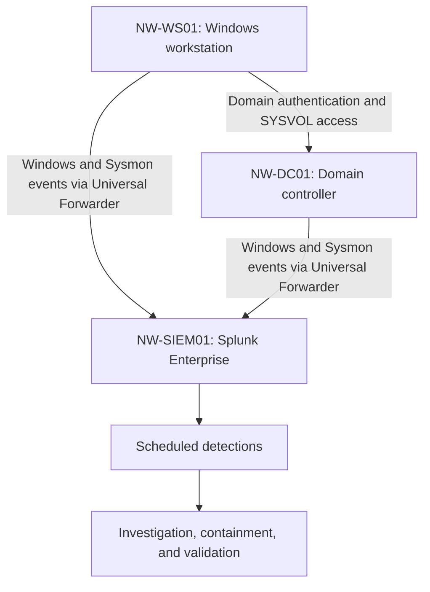

# Operation NightWatch

A local Windows and Active Directory SOC lab demonstrating detection engineering, investigation, and response using Splunk, Sysmon, and Windows Security logs.

## Environment

| System | Role | Lab IP |
|---|---|---|
| NW-SIEM01 | Ubuntu / Splunk Enterprise | 192.168.56.30 |
| NW-DC01 | Windows Server / Active Directory | 192.168.56.10 |
| NW-WS01 | Domain-joined Windows workstation | 192.168.56.20 |

Domain: `nightwatch.test`. Virtual machines run in VirtualBox on a host-only lab network.

## Architecture

## Investigations

| Case | Focus | Report |
|---|---|---|
| NW-001 | Encoded PowerShell; decoding and process activity review | [Investigation](investigations/NW-001-encoded-powershell-investigation.md) |
| NW-002 | Repeated failed logons; threshold validation | [Investigation](investigations/NW-002-repeated-failed-logons.md) |
| NW-003 | WScript launching PowerShell; process-chain analysis | [Investigation](investigations/NW-003-wscript-powershell.md) |
| NW-004 | Registry Run-key persistence; login execution and cleanup | [Investigation](investigations/NW-004-run-key-persistence.md) |
| NW-005 | Combined domain-account incident simulation and containment | [Incident report](investigations/NW-005-domain-account-incident-report.md) |

## Detection Engineering

Four SPL rules were exercised with scheduled alerting and investigation evidence. See [queries, alert settings, and limitations](detections/README.md).

- [Encoded PowerShell](detections/NW-001-encoded-powershell.spl)
- [Repeated failed logons](detections/NW-002-repeated-failed-logons.spl)
- [WScript-launched PowerShell](detections/NW-003-wscript-powershell.spl)
- [Registry Run-key modification](detections/NW-004-run-key-modification.spl)

A detection match is an investigation lead, not proof of malicious activity. Legitimate startup software also matched the Run-key rule.

## Combined Incident Findings

Case 5 correlated repeated failures, successful account use, encoded execution, per-user persistence, and domain-controller authentication across October 14-15, 2026.

Containment included disabling the dedicated test account, removing persistence, stopping remaining account-owned processes, checking SMB sessions, and confirming a fresh login was rejected.

The exercise demonstrated domain-account activity and workstation persistence. It did not establish credential theft, privilege escalation, remote execution on the domain controller, or domain takeover.

## Evidence

- [Screenshots](evidence/screenshots/)
- [Case 5 selected-event timeline CSV](evidence/exports/nightwatch-case5-incident-timeline.csv)

The Case 5 export contains 217 selected events. It is a filtered export, not a complete forensic acquisition. Reports distinguish exported evidence from operator observations.

## Lessons and Limitations

- Account disablement does not automatically terminate existing processes or every session.
- The account running PowerShell determines which user hive HKCU refers to.
- VM clock skew affected relative-time searches; a permanent correction was not validated.
- Fixed five-minute buckets can miss failures split across boundaries.
- Detection coverage is intentionally narrow and documented per rule.

## Project Scope

All scenario activity was authorized and performed against a dedicated local lab. Payloads used harmless test output or Notepad. The repository documents the observed results and their limits.
