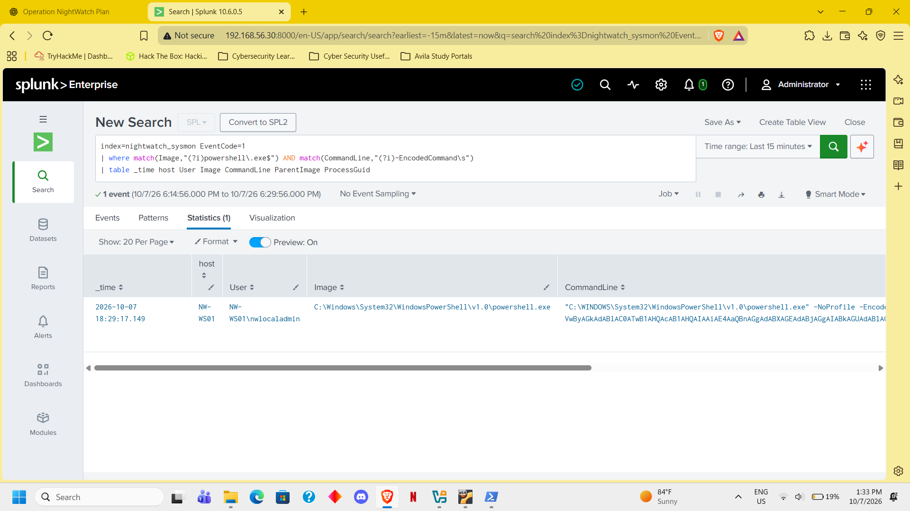
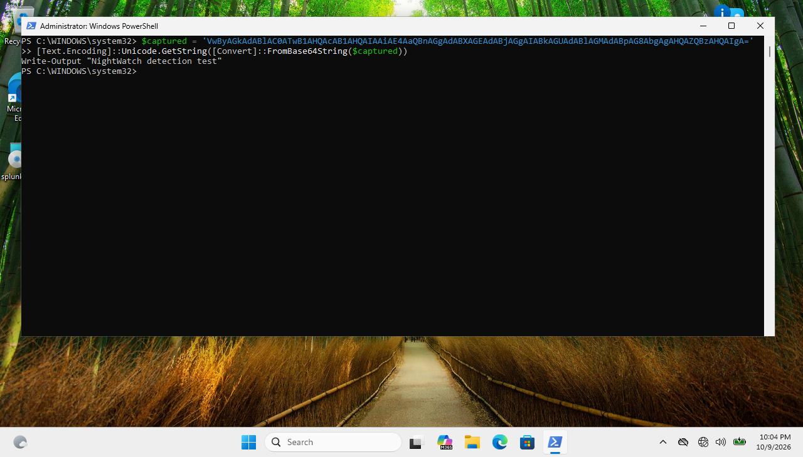
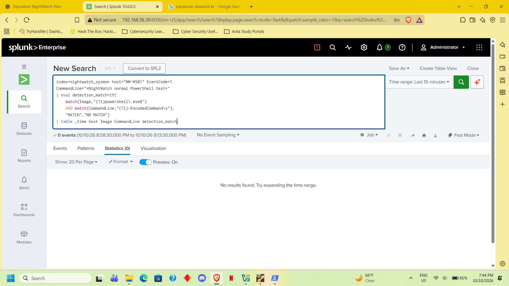

Alert: NW - Encoded PowerShell Execution
Host / user: NW-WS01 / nwlocaladmin
Finding: PowerShell ran with -EncodedCommand; the scheduled alert triggered.
Decoded command: Write-Output "NightWatch dutection test" — harmless test text.
Activity reviewed: Temporary PowerShell policy-test files and certificate-store registry key creation. No child processes appeared in the returned results.
Negative test: Normal PowerShell execution returned NO MATCH.
Disposition: Authorized benign test. Detection worked; encoding alone does not prove malicious activity.

<!-- evidence-gallery -->
## Evidence screenshots

### encoded powershell detected

### encoded powershell decoded

### encoded powershell negative test

