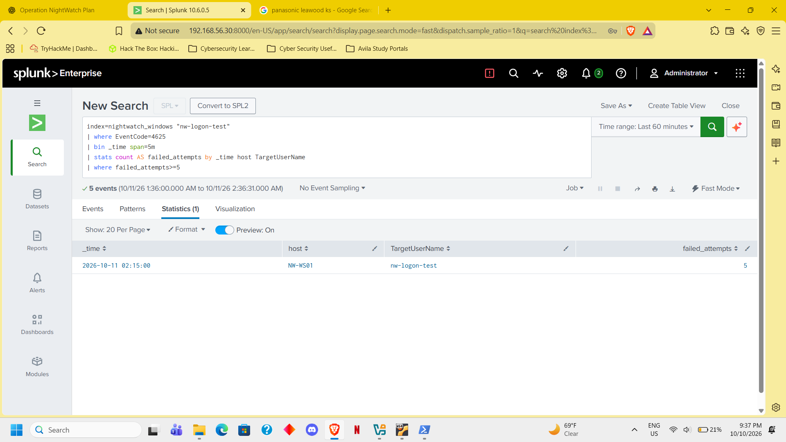
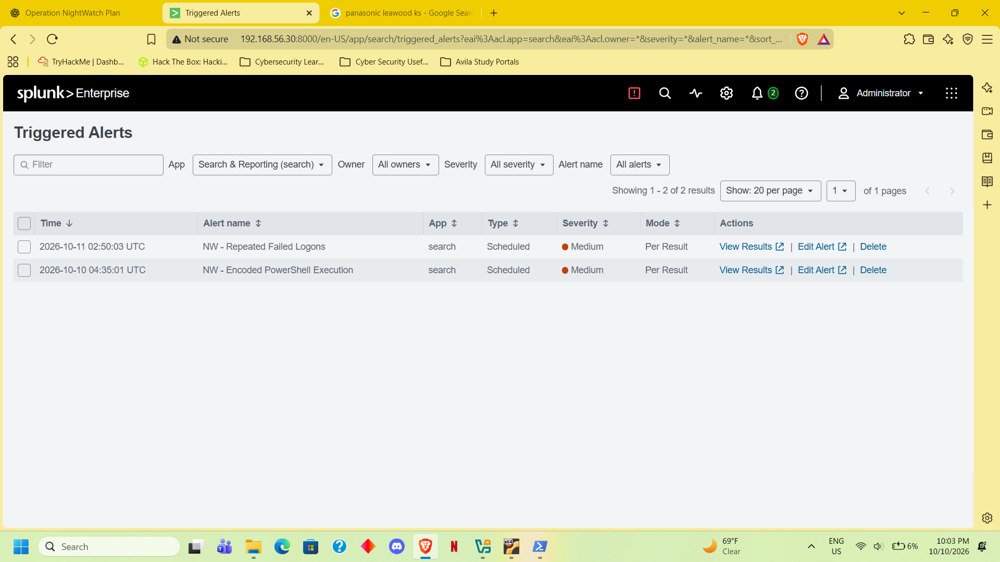
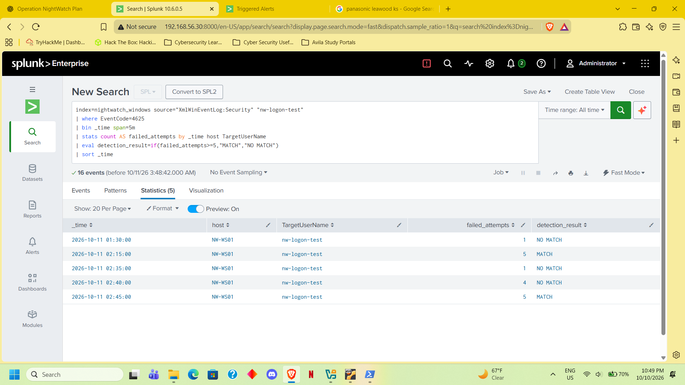

# NW-002 — Repeated Failed Logons

- Alert: NW - Repeated Failed Logons
- Host: NW-WS01
- Account: NW-WS01\nw-logon-test
- Activity: Authorized local failed-login test using runas.
- Detection: At least 5 Security Event 4625 failures per host,
  domain, and account within a fixed five-minute bucket.
- Positive validation: Groups of 5 failures returned MATCH.
- Negative validation: Groups of 1 and 4 returned NO MATCH.
- Investigation: Source address ::1 and LogonType 2.
  No successful logons appeared in the reviewed results.
- Disposition: Authorized test; repeated failures alone do
  not prove an account compromise.
- Troubleshooting: Corrected SIEM clock skew that excluded
  events from relative-time searches.
- Limitation: Failures split across adjacent five-minute
  buckets may remain below the threshold.

<!-- evidence-gallery -->
## Evidence screenshots

### repeated failed logons detected

### repeated failed logons alert triggered

### failed logons threshold validation

