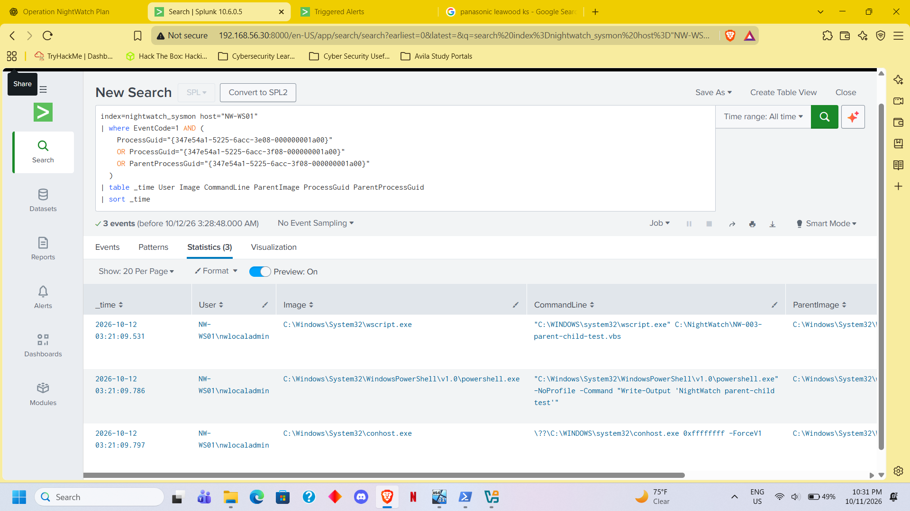
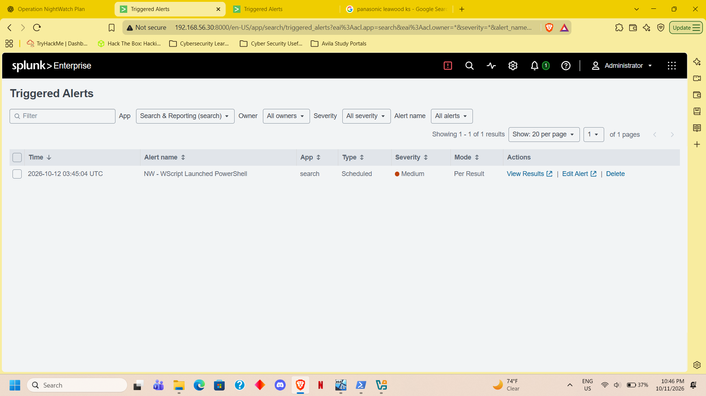
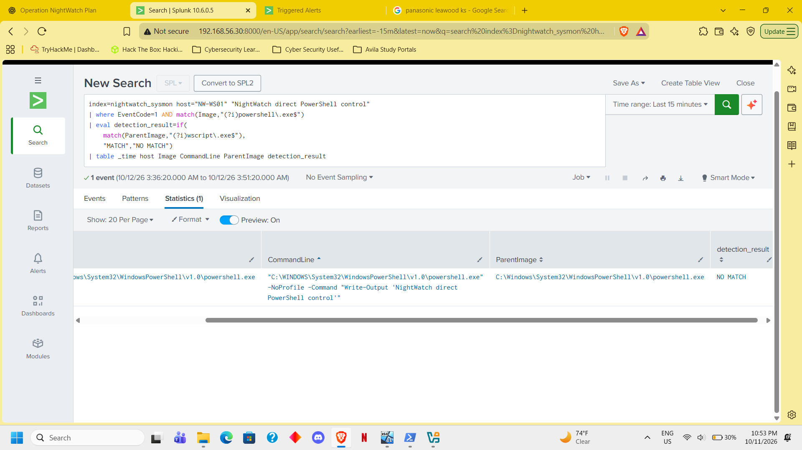

# NW-003 — WScript Launched PowerShell

- Host / user: NW-WS01 / nwlocaladmin
- Detection: Sysmon process creation showing powershell.exe
  launched directly by wscript.exe.
- Test script: C:\NightWatch\NW-003-parent-child-test.vbs
- Command: Write-Output 'NightWatch parent-child test'
- Process chain: PowerShell terminal → WScript → PowerShell
  → conhost.exe, correlated using process GUIDs.
- Activity review: File and registry events were present.
  No network or DNS events appeared in the uploaded rows.
- Positive test: Script-launched PowerShell matched.
- Negative test: Direct PowerShell execution returned NO MATCH.
- Disposition: Authorized benign test.
- Limitation: This rule covers wscript.exe → powershell.exe;
  it does not cover other script hosts or indirect launches.

<!-- evidence-gallery -->
## Evidence screenshots

### script powershell process chain

### wscript powershell alert triggered

### wscript powershell negative test

