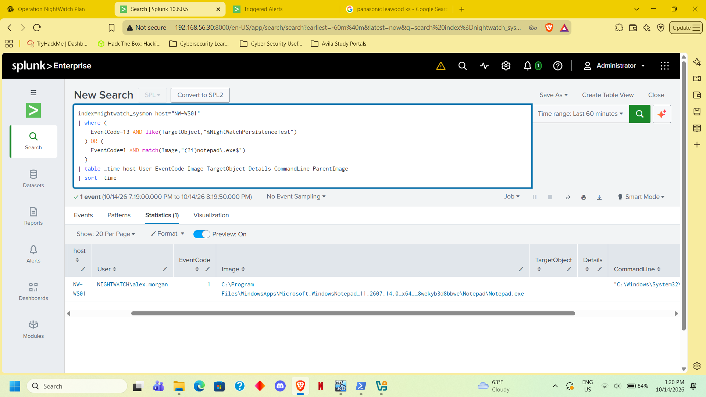
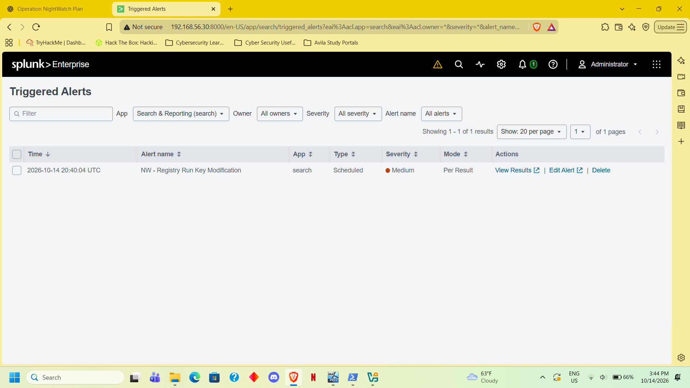
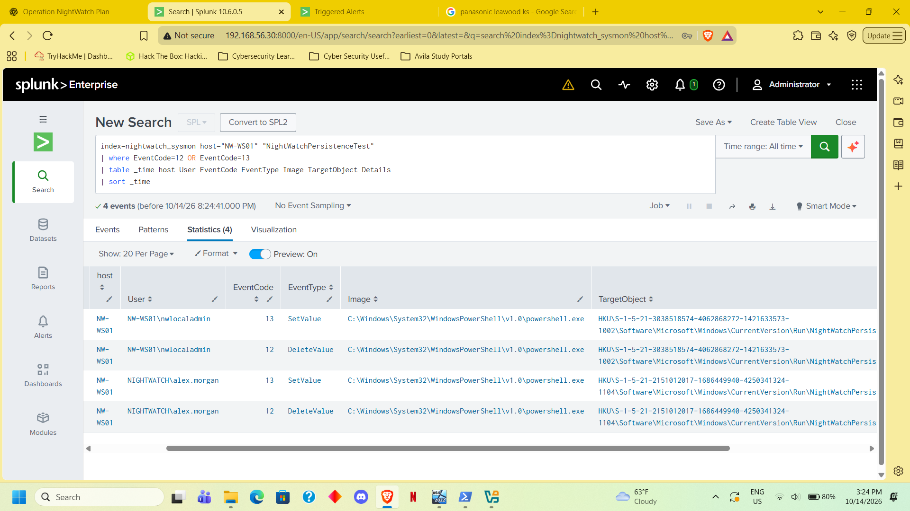

# NW-004 — Registry Run Key Persistence

- Host: NW-WS01
- Account: NIGHTWATCH\alex.morgan
- Test: Created the HKCU Run value NightWatchPersistenceTest,
  pointing to C:\Windows\System32\notepad.exe.
- Execution: Notepad opened automatically after Alex signed in.
- Evidence: Sysmon recorded registry creation and deletion.
- Detection: NW - Registry Run Key Modification.
- Alert validation: Scheduled alert triggered; trigger and
  result screenshots captured.
- Response: Removed the test value. User confirmed Notepad
  no longer opened automatically after signing in.
- Final alert test: Recreated and immediately removed the value;
  the creation event still triggered the alert.
- Baseline: The rule also matched Edge auto-launch entries.
  A Run-key change alone does not establish malicious intent.
- Disposition: Authorized benign persistence simulation.
- Scope: Current rule covers Run value changes, not RunOnce
  or other persistence mechanisms.

<!-- evidence-gallery -->
## Evidence screenshots

### run key persistence timeline

### run key alert triggered

### run key creation removal

